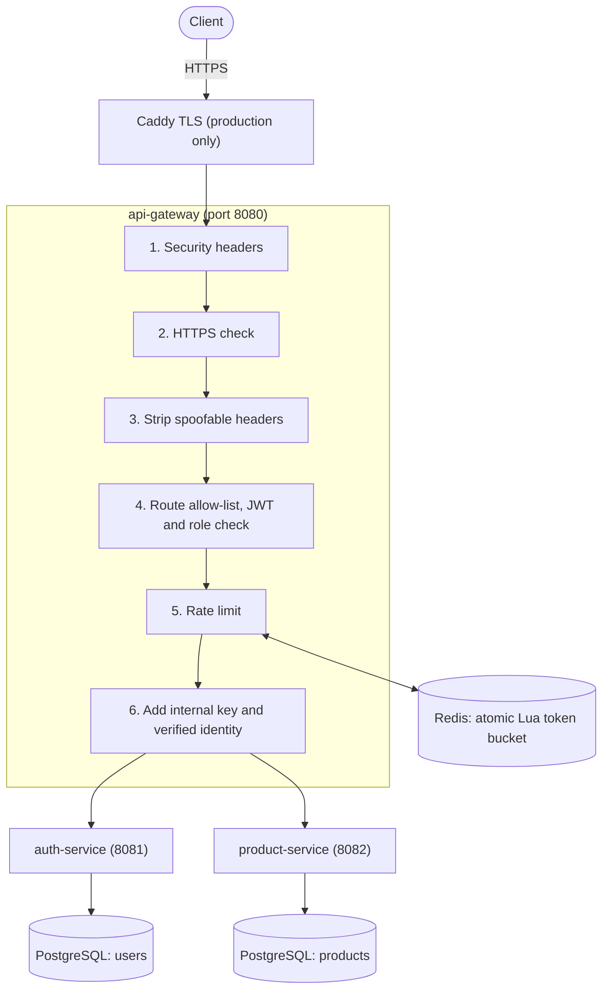

# API Rate Limiter & Authentication Gateway

A security-focused API gateway built with **Spring Cloud Gateway** (reactive). It sits in front of two Spring Boot
services and handles authentication, authorization and rate limiting in one place, so the services behind it only
contain business logic.

## Features

- **JWT authentication:** short-lived (15 min) HS256 tokens; the gateway checks signature, issuer, audience, expiry and role.
- **Role-based access control:** `ADMIN`, `SELLER` and `CUSTOMER`, enforced at the gateway and again inside each service.
- **Redis token-bucket rate limiting:** atomic Lua script, per-user and per-IP limits, `429` with `Retry-After`.
- **Login protection:** BCrypt password hashing, per-IP login limits and temporary account lockout after repeated failures.
- **Deny-by-default routing:** only listed method + path combinations are forwarded; everything else is rejected.
- **Private backends:** services and databases live on an internal Docker network and refuse requests that did not come through the gateway.
- **Hardening:** strict input validation, security headers, HTTPS enforcement, secrets only from environment variables, non-root read-only containers.

## Architecture



Only the gateway is reachable. The backends sit on a private Docker network and additionally refuse any request that
does not carry the gateway's secret internal key, so the identity headers the gateway adds can be trusted.

## Tech stack

| Area | Technology |
|---|---|
| Language / framework | Java 21, Spring Boot 3.5, Spring Cloud Gateway (WebFlux / Netty) |
| Persistence | PostgreSQL 16, Spring Data JPA / Hibernate |
| Rate limiting | Redis 7 (reactive Lettuce client, Lua script) |
| Security | JJWT, BCrypt (Spring Security Crypto) |
| Testing | JUnit 5, Mockito, AssertJ, MockMvc |
| Delivery | Docker Compose, GitHub Actions, Caddy (TLS) |

## Quick start

**Prerequisite:** Docker Desktop. Commands below are for Windows PowerShell. On Linux/macOS, `docker compose` works the
same way, and the helper scripts need PowerShell 7 (`pwsh`), or you can use the Postman collection instead.

**1. Create your secrets file** (random secrets are generated for you; `.env` is git-ignored):

```powershell
.\scripts\generate-env.ps1
```

It prints the first admin password **once**, so save it. Before the first start you can also change
`BOOTSTRAP_ADMIN_USERNAME` in `.env` to something less guessable than `admin`.

**2. Start everything:**

```powershell
docker compose -f docker-compose.yml -f docker-compose.local.yml up --build
```

The first build takes a few minutes. It is ready when all three services log `Started ...Application`.

**3. Check it works.** In a second PowerShell window:

```powershell
.\scripts\load-env.ps1
.\scripts\smoke-test.ps1
```

The smoke test runs 27 end-to-end checks (authentication, roles, validation, security headers, rate limiting).
Every line should print `[PASS]`.

Stop with `docker compose -f docker-compose.yml -f docker-compose.local.yml down`
(add `-v` to also delete the databases).

## Try the API

You can use the Postman collection in `postman/` (import it, set `adminUsername` and `adminPassword`, then run it), or send requests yourself.

```http
POST http://localhost:8080/auth/register
Content-Type: application/json

{ "username": "alice", "password": "<a password with 10+ characters, a letter and a digit>" }
```

```http
POST http://localhost:8080/auth/login
Content-Type: application/json

{ "username": "alice", "password": "<the same password>" }
```

The login response contains an `accessToken`. Send it on later requests:

```http
GET http://localhost:8080/products
Authorization: Bearer <accessToken>
```

## API reference

| Method and path | Who can call it | Rate limit |
|---|---|---|
| `POST /auth/register` | Public (always creates a `CUSTOMER`) | 10 per 10 min per IP |
| `POST /auth/login` | Public | 10 per min per IP, plus account lock after 5 failures |
| `GET /products`, `GET /products/{id}` | Any logged-in role | 60 per min per user |
| `POST /products` | `ADMIN`, `SELLER` | 20 per min per user |
| `DELETE /products/{id}` | `ADMIN` (any), `SELLER` (own products only) | 20 per min per user |
| `GET /auth/admin/users` | `ADMIN` | 60 per min per user |
| `PUT /auth/admin/users/{username}/role` | `ADMIN` | 20 per min per user |

Other requests return `404` (unknown path), `405` (wrong method) or `400` (unsafe path). Tokens last 15 minutes.
Passwords must be 10-72 characters, contain a letter and a digit, and must not contain the username.

Rate-limited responses return `429` with a `Retry-After` header; successful ones carry `X-RateLimit-Remaining`.
If Redis is unavailable, login and register return `503` and the other routes keep working. This behaviour is configurable per route group; see [SECURITY.md](SECURITY.md).

## Security

The security design (trust model, failure behaviour, known limitations and a pre-deployment checklist) is documented
in [SECURITY.md](SECURITY.md).

## Testing

```powershell
cd auth-service;    mvn test; cd ..
cd product-service; mvn test; cd ..
cd api-gateway;     mvn test; cd ..
```

Requires JDK 21 and Maven. The tests cover JWT attack cases (tampered, expired, `alg:none`, wrong algorithm), role
and ownership checks, password and input validation, account lockout, client-IP handling, security headers and the
rate limiter. The token-bucket integration test needs a real Redis and skips itself when none is running; to include it:

```powershell
docker compose -f docker-compose.yml -f docker-compose.local.yml up -d redis
.\scripts\load-env.ps1
cd api-gateway; mvn test
```

GitHub Actions runs all three test suites (with a Redis service) and a secret scan on every push.

## Run the services from an IDE

```powershell
docker compose -f docker-compose.yml -f docker-compose.local.yml up -d redis auth-db product-db
```

Then, in one PowerShell window per service, started in the project root:

```powershell
.\scripts\load-env.ps1; cd auth-service;    mvn spring-boot:run
.\scripts\load-env.ps1; cd product-service; mvn spring-boot:run
.\scripts\load-env.ps1; cd api-gateway;     mvn spring-boot:run
```

## Deployment

A production override (`docker-compose.prod.yml`) adds a Caddy reverse proxy that obtains TLS certificates
automatically and makes the gateway enforce HTTPS. It has been verified locally but **not yet run on a live server**.
Outline for a single VPS:

1. Point a DNS name at the server and install Docker.
2. Run `scripts/generate-env.sh`, then edit `.env`: set `DOMAIN` and, if you have a front end, `CORS_ALLOWED_ORIGINS`.
3. Start it: `docker compose -f docker-compose.yml -f docker-compose.prod.yml up -d --build`
4. Remove the two `BOOTSTRAP_ADMIN_*` lines from `.env` after the first start.

Read the checklist in [SECURITY.md](SECURITY.md) before going live.

## Troubleshooting

| Problem | Fix |
|---|---|
| `failed to connect to the docker API` | Start Docker Desktop and wait for "Engine running". |
| `variable is missing a value: set X in .env` | Run `.\scripts\generate-env.ps1` in the project folder (`.env` must sit next to `docker-compose.yml`). |
| `running scripts is disabled` / `not digitally signed` | In that window run `Set-ExecutionPolicy -Scope Process -ExecutionPolicy Bypass`. |
| `port is already allocated` | Another program uses port 8080, 5432 or 6379. Close it and retry. |
| `429` while testing | The rate limiter is working. Wait, or reset it: `docker compose -f docker-compose.yml -f docker-compose.local.yml restart redis`. |
| Registration rejects your password | Use 10-72 characters with at least one letter and one digit. |

## Project layout

```
auth-service/      users, BCrypt, lockout, JWT issuing, admin user routes   (Spring MVC, JPA, PostgreSQL)
product-service/   product CRUD with ownership checks                        (Spring MVC, JPA, PostgreSQL)
api-gateway/       filters, route policy, JWT validation, rate limiter       (Spring Cloud Gateway, reactive)
scripts/           generate-env, load-env, smoke-test, audit, backup
postman/           importable collection
```

## Author

Built by [@ajayreddy30](https://github.com/ajayreddy30).
